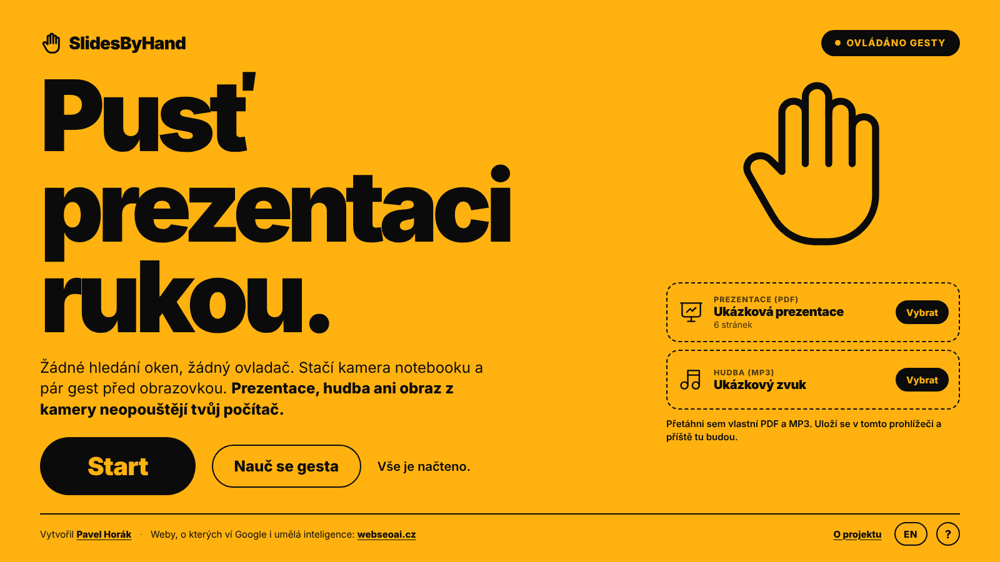

# SlidesByHand

 

**Pusť prezentaci rukou.** Bez ovladače, bez instalace, bez účtu. Běží v prohlížeči a nic neopouští tvůj počítač.

**[Vyzkoušej na slidesbyhand.com](https://slidesbyhand.com)** · [English](README.md)

## Co to je

Připojíš notebook k televizi nebo projektoru, otevřeš jednu stránku a prezentaci ovládáš rukama před kamerou notebooku. Ukážeš otevřenou dlaň a prezentace se spustí. Ukážeš prstem do strany a stránka se otočí. Zvedneš oba ukazováky a máš ukazovátko, které sleduje špičku prstu.

Vzniklo to jako řešení známé chvíle na setkáních: místnost čeká, než řečník najde správné okno. Teď je prezentace jedna stránka, která už je otevřená, a řečník na notebook vůbec nesáhne.

## Gesta

| Gesto | Co dělá |
|---|---|
| Otevřená dlaň | Spustí prezentaci |
| Ukazovák doprava | Další stránka |
| Ukazovák doleva | Předchozí stránka |
| Oba ukazováky nahoru | Zapne ukazovátko. Červená tečka sleduje špičku prstu |
| Oba ukazováky dolů | Vypne ukazovátko |
| Pěst | Ukončí prezentaci |

Každé gesto je potřeba chvíli podržet a na obrazovce se přitom plní kroužek. Nic se nespustí omylem a publikum vidí, co se děje.

Existuje ještě jedno gesto, které v seznamu není. Najdeš ho v nápovědě pod otazníkem.

## Vlastní prezentace a hudba

Přetáhni do stránky PDF a MP3. Uloží se v tvém prohlížeči na tvém počítači a příště tam budou. Vždy je tam jedna prezentace a jeden zvuk, nový soubor nahradí starý.

PowerPoint, Keynote i Google Slides umí prezentaci uložit jako PDF. V PowerPointu: Soubor, Uložit jako, PDF.

Dokud nenahraješ vlastní, stránka používá krátkou ukázkovou prezentaci, která učí gesta.

## Nauč se gesta

Na úvodní obrazovce je tlačítko **Nauč se gesta**. Provede tě všemi šesti gesty jedno po druhém, ukazuje, co kamera vidí, a každé gesto potvrdí, když ho uděláš správně. Při zkoušce se nic nespouští.

## Soukromí

- Obraz z kamery se zpracovává v tvém prohlížeči. Nenahrává se, neukládá a nikam se neposílá.
- Prezentace i hudba zůstávají v úložišti prohlížeče na tvém počítači.
- Žádné účty, žádné cookies, žádné sledování.
- Kód je otevřený, takže si to všechno můžeš ověřit.

## Dobré vědět

- Vyzkoušeno v Chromu na notebooku. Jiné moderní prohlížeče by měly fungovat, ale zatím nejsou otestované.
- První načtení má asi 30 MB, většinu tvoří model pro rozpoznávání rukou. Po načtení už stránka připojení nepotřebuje.
- Kamera notebooku musí vidět řečníka. Natoč notebook k sobě.
- Gesta potřebují rozumné světlo. Když rozpoznávání selže, funguje záloha na klávesnici: Enter spustí, šipky listují, Backspace ukončí, U přepíná ukazovátko.
- Česky a anglicky, přepíná se v patičce.

## Vlastní kopie

Celá aplikace jsou statické soubory. Udělej si fork repozitáře, zapni GitHub Pages pro větev `main` a máš vlastní kopii. Žádné sestavování, žádný server, nic k instalaci.

## Postaveno na

- [MediaPipe Hand Landmarker](https://ai.google.dev/edge/mediapipe/solutions/vision/hand_landmarker) pro sledování rukou (Apache 2.0)
- [PDF.js](https://mozilla.github.io/pdf.js/) pro vykreslení stránek (Apache 2.0)
- [Tabler Icons](https://tabler.io/icons) (MIT) a písmo [Inter](https://rsms.me/inter/) (OFL)
- Ukázkový potlesk z [BigSoundBank](https://bigsoundbank.com/applause-from-40-people-5-s3521.html) (CC0)

Gesta se poznávají čistou geometrií nad body ruky: vzdálenosti a směry prstů. V rozhodování, co gesto znamená, žádná AI není.

## Autor

**Pavel Horák**. Stavím weby a webové aplikace.

- Další moje projekty: [pprojects.cz](https://pprojects.cz)
- Weby, o kterých ví Google i umělá inteligence: [webseoai.cz](https://webseoai.cz)
- [LinkedIn](https://www.linkedin.com/in/pavelhorakeu) · [X](https://x.com/PavelHorakCZ)

**Chceš něco podobného pro svou firmu?** Napiš mi přes [hodinovyvibecoder.cz](https://hodinovyvibecoder.cz).

## Licence

[MIT](LICENSE). Používej, upravuj, stav na tom.

Pokud SlidesByHand použiješ nebo na něm postavíš něco vlastního, nech prosím na viditelném místě odkaz na [slidesbyhand.com](https://slidesbyhand.com). Licence to nevyžaduje, jen o to prosím.

Licence přibalených knihoven jsou v souboru [THIRD-PARTY-NOTICES.md](THIRD-PARTY-NOTICES.md).
