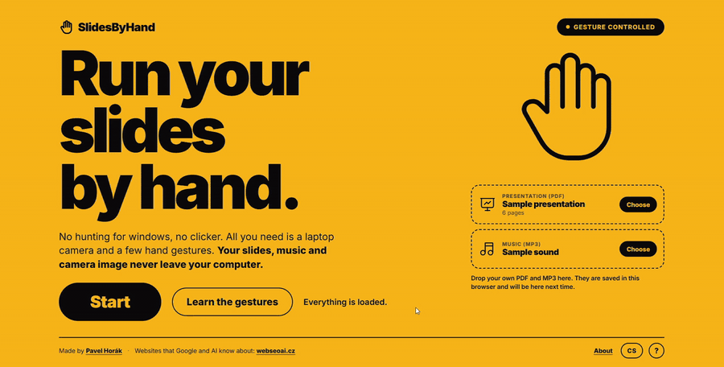

# SlidesByHand

 

**Run your slides with hand gestures.** No clicker, no install, no account. It runs in your browser and nothing leaves your computer.

**[Try it at slidesbyhand.com](https://slidesbyhand.com)** · [Česky](README.cs.md)

## What it is

You connect a laptop to a TV or projector, open one page and control your presentation with your hands in front of the laptop camera. Show an open palm and the slides start. Point your finger to the side and the page turns. Raise both index fingers and you get a pointer that follows your fingertip.

It started as a fix for a familiar moment at meetups: a room waiting while the speaker hunts for the right window. Now the presentation is one page that is already open, and the speaker never touches the laptop.

## Gestures

| Gesture | What it does |
|---|---|
| Open palm | Starts the presentation |
| Index finger right | Next page |
| Index finger left | Previous page |
| Both index fingers up | Turns the pointer on. A red dot follows your fingertip |
| Both index fingers down | Turns the pointer off |
| Fist | Ends the presentation |

Every gesture has to be held for a moment, and a ring on the screen fills up while you hold it. Nothing fires by accident, and the audience can see what is happening.

There is one more gesture that is not on the list. You will find it in the help under the question mark.

## Your own slides and music

Drag a PDF and an MP3 onto the page. They are stored in your browser, on your computer, and they are there next time. There is always one presentation and one sound; a new file replaces the old one.

PowerPoint, Keynote and Google Slides can all export to PDF. In PowerPoint: File, Save As, PDF.

Until you add your own, the page uses a short sample presentation that teaches the gestures.

## Learn the gestures

The start screen has a **Learn the gestures** button. It walks you through all six gestures one by one, shows what the camera sees and confirms each gesture when you get it right. Nothing is started while you practise.

## Privacy

- The camera image is processed in your browser. It is not recorded, stored or sent anywhere.
- Your presentation and music stay in your browser's storage on your computer.
- There are no accounts, no cookies and no tracking.
- The code is open, so you can check all of the above yourself.

## Good to know

- Tested in Chrome on a laptop. Other modern browsers should work but have not been tested yet.
- The first load is about 30 MB, mostly the hand recognition model. After the page has loaded it needs no connection.
- The laptop camera has to see the speaker. Turn the laptop towards yourself.
- Gestures need reasonable light. If recognition fails, the keyboard works as a backup: Enter starts, arrows turn pages, Backspace ends, U toggles the pointer.
- English at [slidesbyhand.com](https://slidesbyhand.com) and Czech at [slidesbyhand.com/cs/](https://slidesbyhand.com/cs/).
- More reading: [what it is and FAQ](https://slidesbyhand.com/about/), [step by step guide](https://slidesbyhand.com/how-to-control-slides-with-hand-gestures/), [clicker comparison](https://slidesbyhand.com/presentation-clicker-alternative/).

## Run your own copy

The whole site is static files. Fork the repository, turn on GitHub Pages for the `main` branch and you have your own copy. No server, no dependencies to install.

The English version lives at the root and the Czech one in `/cs/`. Both, together with the content pages, the sitemap and `llms.txt`, are generated from one source by `build.py`. The generated files are committed, so you only need to run `python3 build.py` after you change something in `src/`.

## Built with

- [MediaPipe Hand Landmarker](https://ai.google.dev/edge/mediapipe/solutions/vision/hand_landmarker) for hand tracking (Apache 2.0)
- [PDF.js](https://mozilla.github.io/pdf.js/) for rendering slides (Apache 2.0)
- [Tabler Icons](https://tabler.io/icons) (MIT) and the [Inter](https://rsms.me/inter/) typeface (OFL)
- Sample applause from [BigSoundBank](https://bigsoundbank.com/applause-from-40-people-5-s3521.html) (CC0)

Gestures are recognized by plain geometry over the hand points: distances and directions of fingers. There is no AI in deciding what a gesture means.

## Author

**Pavel Horák**. I build websites and web apps.

- More of my projects: [pprojects.cz](https://pprojects.cz)
- Websites that Google and AI know about: [webseoai.cz](https://webseoai.cz)
- [LinkedIn](https://www.linkedin.com/in/pavelhorakeu) · [X](https://x.com/PavelHorakCZ)

**Want something like this for your company?** Write to me through [hodinovyvibecoder.cz](https://hodinovyvibecoder.cz).

## License

[MIT](LICENSE). Use it, change it, build on it.

If you use SlidesByHand or build on it, please keep a visible link to [slidesbyhand.com](https://slidesbyhand.com). The license does not require it. I am simply asking.

Licenses of the bundled libraries are listed in [THIRD-PARTY-NOTICES.md](THIRD-PARTY-NOTICES.md).
